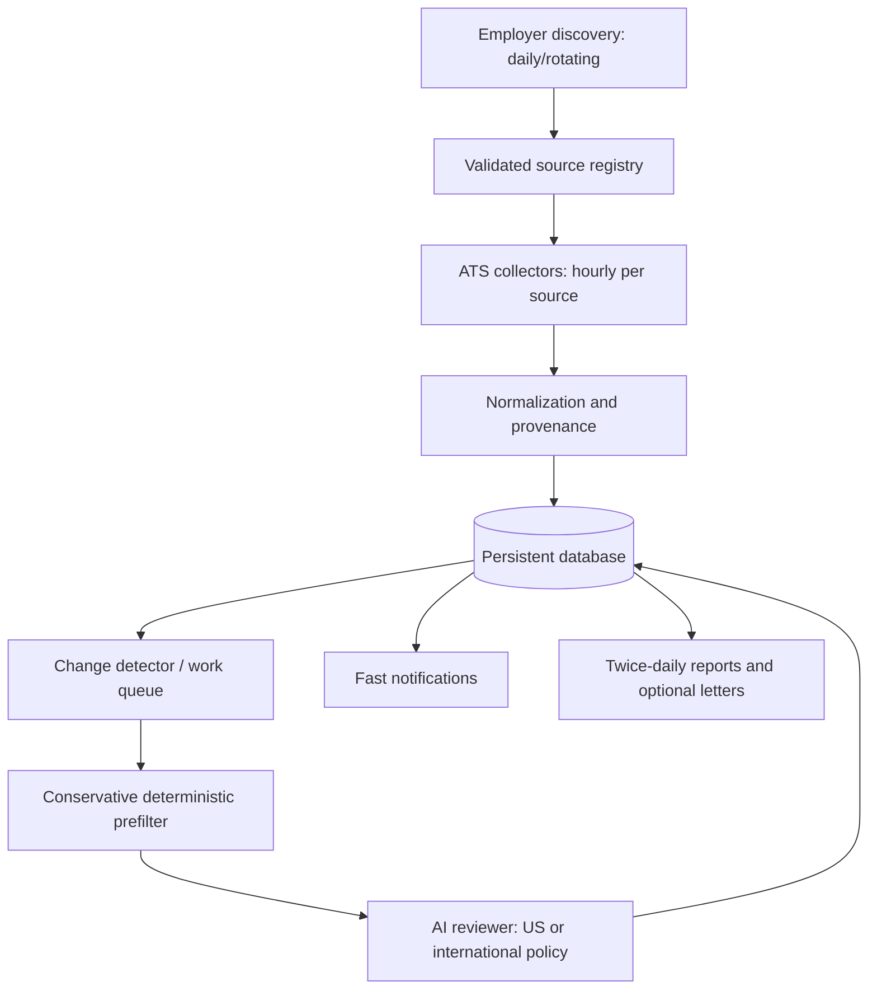

# System architecture

> Implementation update: the integrated workflow is now implemented in
> `sources/`, `discovery/`, `ingestion/`, `screening/`, `reporting/` and
> `operations/`. [ADR 0008](adr/0008-integrated-personal-workflow.md) supersedes
> earlier phase limits. The package map below describes the current tree.
> No server or dashboard was added.

## Style

**Modular monolith:** one Python codebase and one persistent database, with a scheduler/CLI invoking separable components. No HTTP server is needed in the initial version. See [ADR 0001](adr/0001-modular-monolith.md).



## Responsibility boundaries

| Component | Owns | Explicitly does **not** own |
| --- | --- | --- |
| Discovery | Finding employers, verifying official source mappings, proposing registry entries | Screening every vacancy in depth |
| Source registry | Employer/source identity, poll configuration, provenance and health | Fetching job descriptions |
| Collectors | GET/read-only provider data; pagination, timeouts, bounded retries | Screening or application submission |
| Normalizer | Converting source payloads into a common posting shape | Inventing missing publication dates |
| Persistence | Atomic upserts, version/evidence storage, unique keys | Selecting jobs to recommend |
| Change detector | Finding new/changed/missing/reappeared IDs after **successful complete** polls | Declaring a job closed on source failure |
| Screening | Policy checks, AI review, evidence and uncertainty | Editing raw source records |
| Delivery | Idempotent notifications and reports | Changing application status without user input |

## Current package layout

```text
src/jobsfinder_io/
  cli.py             # argparse commands and environment configuration
  registry.py        # employer/source registration and validation
  discovery/         # official-page discovery, inputs and durable rotation
  sources/           # Greenhouse, Lever/global/EU and Ashby adapters
  ingestion/         # polling, snapshots and safe reconciliation
  persistence/       # SQLAlchemy models and database connections
  screening/         # Gemini batches, evidence, queue, quotas and sessions
  reporting/         # reports and independent non-AI reporting
  delivery/          # local artifacts, SMTP and optional Telegram
  operations/        # run-due orchestration and report slots
  relevance.py       # conservative relevance checks
  runlock.py         # process locks and interrupted-work recovery
migrations/          # versioned Alembic schema
tests/               # offline unit/integration regressions and fixtures
```

## Important sequences

### New monitored source

1. Validate provider, employer ownership, accessible endpoint and terms/permissions.
2. Register and validate the source before polling; the first successful complete poll establishes its baseline.
3. Perform a **complete successful baseline scan**; persist all visible postings with `first_seen_at` and `discovery_kind=baseline`.
4. Do not claim these already-visible listings were published during the last polling interval.
5. Subsequent complete scans identify newly observed IDs; queue relevant postings for screening.

### Subsequent healthy poll

1. Mark poll started with UTC timestamp and source ID.
2. Fetch every required page; note HTTP/cache/conditional responses if supported.
3. On incomplete/error: record failure and preserve existing vacancy state.
4. On complete success: idempotently upsert postings, compare IDs and content fingerprints, update last-seen and evidence.
5. Queue new or materially changed jobs once; reconcile missing jobs conservatively (e.g. require multiple complete misses or direct closure evidence).
6. Process screening and delivery asynchronously or in separately retryable tasks when needed.

### Screening

- Lightweight title/description rules may exclude obvious non-development roles; ambiguous roles stay eligible for review.
- US and international policies are separate configuration modules.
- AI receives cleaned description, country/locale, owner rules from private configuration, and source provenance; returns a typed evidence-backed result.
- Store versioned decisions, human overrides and reasons; notifications do not require a cover letter to finish first.

## Deployment trajectory

Start as a local CLI + SQLite with **SQLAlchemy 2.x models and Alembic migrations from Phase 1** (ADRs 0004 and 0006). PostgreSQL is a possible later deployment choice, not a current requirement. Avoid scheduling hourly checks from a laptop that may be offline.

Phase 3 adds one Docker Compose CLI service and GitHub Actions CI; see
[ADR 0007](adr/0007-docker-and-ci.md). The container uses the existing SQLite path
through a host-directory mount. Migrations remain explicit commands. CI runs
offline tests, style checks, and image/migration/persistence checks without
publishing or deploying. There is still no scheduler or additional service.

## Constraints

- URLs and provider response fields are untrusted input. Sanitize, validate permitted hosts, enforce bounded payload sizes.
- The initial data pipeline must remain useful with AI disabled.
- Source freshness can lag actual employer publication; detect and report that uncertainty.

## Current non-AI operating workflow

The serialized `run-due` command performs discovery (06:00 New York), due source
polling, conservative relevance alerts, and combined reports (10:00/20:00 New
York). It never invokes screening, regardless of keys. Reports preserve unknown
eligibility and distinguish source dates, first discovery and initial baselines.

SMTP uses existing `task_runs` as a grouped durable outbox and `deliveries` for
per-posting/revision reservations; no schema change is needed. Local artifacts
survive SMTP failure. Network calls run outside transactions. Ambiguous sending
requires review rather than automatic replay. Discovery cursors and provenance
survive restarts. Trusted imports/directories provide bounded free coverage;
unknown domains require confirmation. See [deployment](deployment.md).

Optional screening uses a durable per-revision queue and multi-job structured
requests, with separate 09:30/19:30 New York sessions. Its own process lock allows
polling to proceed during API waits; SQLite transactions remain short. Existing
workflow tables hold queue, request, token-cache and Pacific quota state. AI configuration defaults to enabled with a 20-call daily application cap;
activation requires the separate host schedule. See [final pilot](activation-pilot.md)
and [ADR 0011](adr/0011-flash-lite-screening.md).
