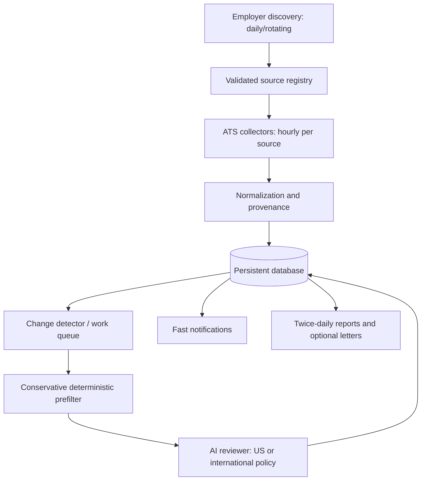

# System Architecture (Proposed v0.1)

## Style

**Modular monolith:** one Python codebase and one persistent database, with a scheduler/CLI invoking separable components. No HTTP server is needed in the initial version. See [ADR 0001](adr/0001-modular-monolith.md).



## Responsibility boundaries

| Component | Owns | Explicitly does **not** own |
| --- | --- | --- |
| Discovery | Finding employers, verifying official source mappings, proposing registry entries | Screening every vacancy in depth |
| Source registry | Employer/source identity, poll configuration, provenance and health | Fetching job descriptions |
| Collectors | GET/read-only provider data; pagination, timeouts, bounded retries | Screening or application submission |
| Normalizer | Converting source payloads into a common posting shape | Inventing missing publication dates |
| Persistence | Atomic upserts, version/evidence storage, unique keys | Selecting jobs to recommend |
| Change detector | Finding new/changed/missing/reappeared IDs after **successful complete** polls | Declaring a job closed on source failure |
| Screening | Policy checks, AI review, evidence and uncertainty | Editing raw source records |
| Delivery | Idempotent notifications and reports | Changing application status without user input |

## Proposed package layout — **not implemented yet**

Phases 1 and 2 implement `cli.py`, `registry.py`, `persistence/`,
`sources/greenhouse.py`, and `ingestion/polling.py`, plus root `migrations/` and
`tests/`. The broader layout below remains a future target. Current model source
statuses take precedence over the future sequence's illustrative `pending_baseline`
state. The approved [Phase 2 design](phase-2-greenhouse-design.md) describes the
implemented manual poll flow and its four-table limits.

```text
src/jobsfinder_io/
  config/            # scheduling, private profile loading and validation
  domain/            # typed entities, enums, business rules
  discovery/         # employer discovery and source validation
  sources/           # greenhouse.py, lever.py, ashby.py, common interface
  ingestion/         # normalization, snapshots, change detection
  persistence/       # database models and repositories
  screening/         # deterministic checks, AI provider, policies
  delivery/          # alerts, digests, cover letters
  jobs/              # orchestration/scheduled entry points
  cli.py             # inspect, poll, rescreen, report commands

tests/
  fixtures/          # synthetic/recorded, redacted provider responses
  unit/
  integration/
```

The directory layout is a target, not a request to generate empty packages. Add folders only when a milestone needs them.

## Important sequences

### New monitored source

1. Validate provider, employer ownership, accessible endpoint and terms/permissions.
2. Save source with status `pending_baseline`.
3. Perform a **complete successful baseline scan**; persist all visible postings with `first_seen_at` and `discovery_type=baseline`.
4. Do not claim these already-visible listings were published during the last polling interval.
5. Subsequent complete scans identify newly observed IDs; queue relevant postings for screening.

### Subsequent healthy poll

1. Mark poll started with UTC timestamp and source ID.
2. Fetch every required page; note HTTP/cache/conditional responses if supported.
3. On incomplete/error: record failure and preserve existing vacancy state.
4. On complete success: idempotently upsert postings, compare IDs and content fingerprints, update last-seen and evidence.
5. Queue new or materially changed jobs once; reconcile missing jobs conservatively (e.g. require multiple complete misses or direct closure evidence).
6. Process screening and delivery asynchronously or in separately retryable tasks when needed.

### Screening

- Lightweight title/description rules may exclude obvious non-development roles; ambiguous roles stay eligible for review.
- US and international policies are separate configuration modules.
- AI receives cleaned description, country/locale, owner rules from private configuration, and source provenance; returns a typed evidence-backed result.
- Store versioned decisions, human overrides and reasons; notifications do not require a cover letter to finish first.

## Deployment trajectory

Start as a local CLI + SQLite with **SQLAlchemy 2.x models and Alembic migrations from Phase 1** (ADRs 0004 and 0006). PostgreSQL is a possible later deployment choice, not a current requirement. Avoid scheduling hourly checks from a laptop that may be offline.

Phase 3 adds one Docker Compose CLI service and GitHub Actions CI; see
[ADR 0007](adr/0007-docker-and-ci.md). The container uses the existing SQLite path
through a host-directory mount. Migrations remain explicit commands. CI runs
offline tests, style checks, and image/migration/persistence checks without
publishing or deploying. There is still no scheduler or additional service.

## Constraints

- URLs and provider response fields are untrusted input. Sanitize, validate permitted hosts, enforce bounded payload sizes.
- The initial data pipeline must remain useful with AI disabled.
- Source freshness can lag actual employer publication; detect and report that uncertainty.
